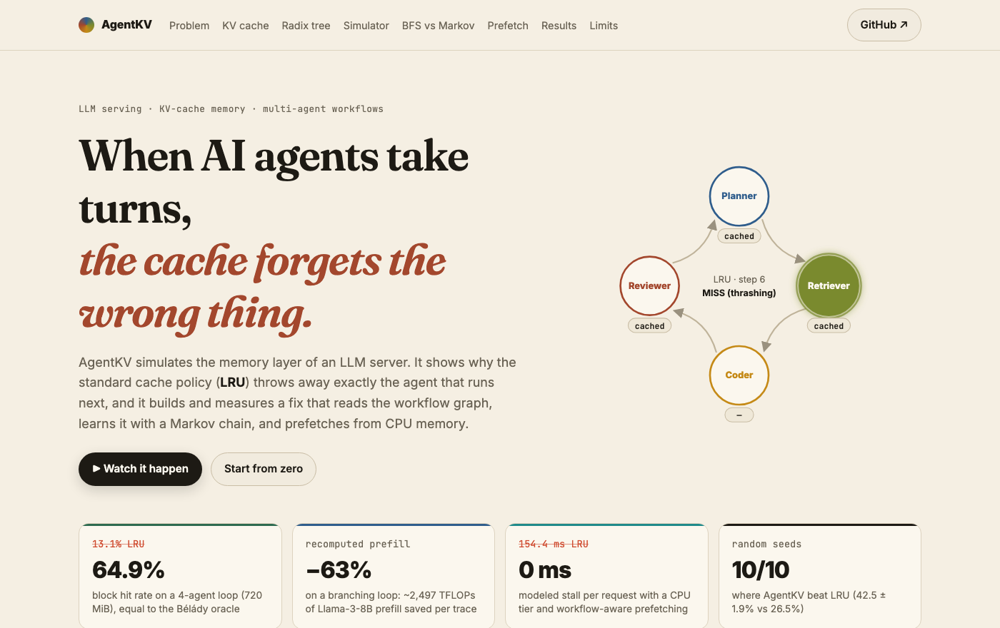
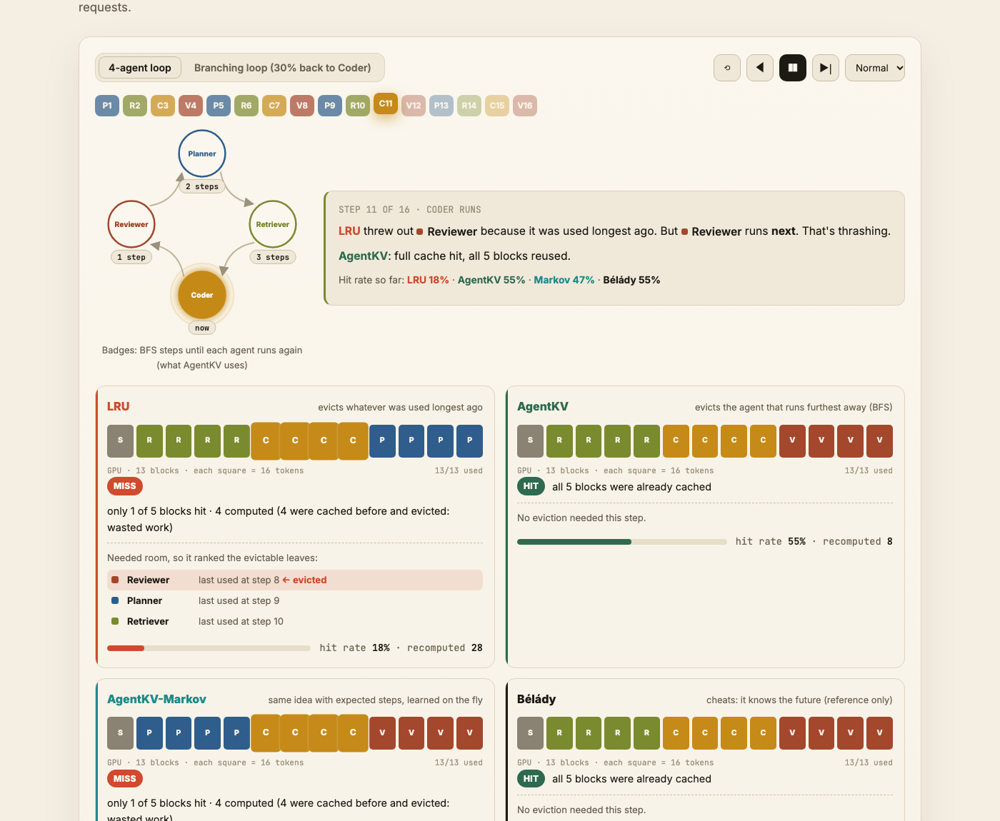
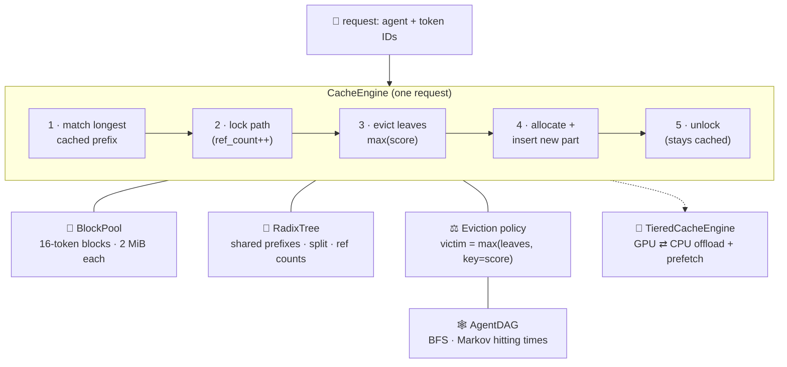
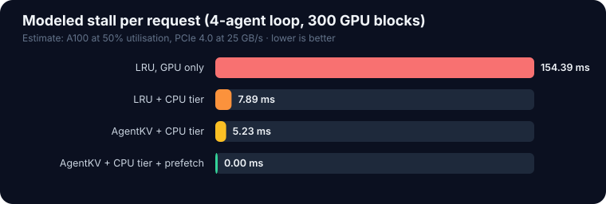
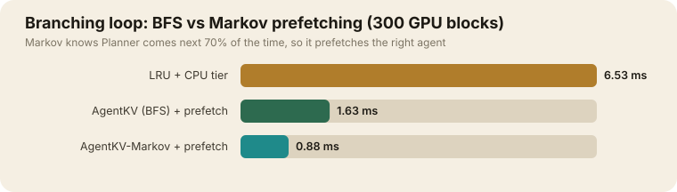
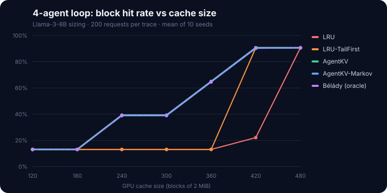
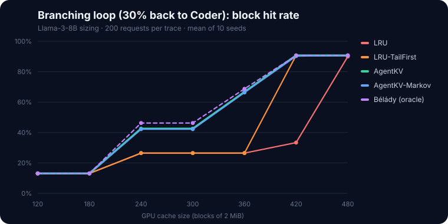

<div align="center">

# 🧠 AgentKV

### When AI agents take turns, the cache forgets the wrong thing.

**A simulator of the KV-cache memory layer of an LLM server running multi-agent workflows.**<br>
It shows why the standard cache policy (LRU) thrashes in agent loops, then builds and measures a fix that
reads the workflow graph, learns it with a Markov chain, and prefetches from CPU memory.


[**▶ Live interactive demo**](https://sahil261005.github.io/AgentKV/) &nbsp;·&nbsp;
[**📊 Results**](#-results) &nbsp;·&nbsp;
[**⚙️ How it works**](#%EF%B8%8F-how-it-works) &nbsp;·&nbsp;
[**🚀 Run it**](#-run-it-yourself)


<a href="https://sahil261005.github.io/AgentKV/"></a>

</div>

---

## ⚡ Results at a glance

<table>
<tr>
<td align="center" width="25%"><h2>13.1% → 64.9%</h2>block hit rate on a 4-agent loop<br><sub>matches the Bélády oracle exactly</sub></td>
<td align="center" width="25%"><h2>−63%</h2>recomputed prefill on a branching loop<br><sub>≈ 2,500 TFLOPs saved per trace</sub></td>
<td align="center" width="25%"><h2>154 ms → 0 ms</h2>modeled stall per request<br><sub>CPU tier + workflow-aware prefetch</sub></td>
<td align="center" width="25%"><h2>10 / 10</h2>random seeds won over LRU<br><sub>42.5 ± 1.9% vs 26.5 ± 2.5%</sub></td>
</tr>
</table>

| What was measured | LRU (SGLang default) | **AgentKV** | Notes |
|---|:---:|:---:|---|
| Hit rate, 4-agent loop, 720 MiB cache | 13.1% | **64.9%** | Equal to the "knows the future" Bélády oracle |
| Hit rate, branching loop, 720 MiB cache | 26.5% | **66.7%** | Bélády: 68.7% |
| Recomputed tokens per trace (branching, 720 MiB) | 249,139 | **93,082** | 63% less wasted prefill |
| GPU hit rate with prefetch (branching, 600 MiB) | BFS: 74.6% | **Markov: 82.0%** | The Markov extension cuts waiting by another 46% |
| Ever worse than LRU? | | **Never** | Checked at all 14 points of the capacity sweep |

> [!NOTE]
> It doesn't win everywhere, and the losses are reported too. It **ties** LRU when the agent order is random,
> when one hub agent runs constantly (ReAct), and when most of each prompt is brand-new text.
> See [Where it does not help](#-where-it-does-not-help).

---

## 🧩 The problem

When an LLM reads a prompt, it stores a **key** and a **value** vector for every token in every layer. That
stored data is the **KV cache**. For Llama-3-8B it costs **128 KiB per token**, so GPU memory fills up fast,
and the server must decide what to evict. SGLang uses **LRU**: evict whatever was used longest ago.

Multi-agent frameworks (LangGraph, AutoGen, CrewAI) call the same model with different agents in a loop:


Give the GPU room for **3 of the 4 agents** and watch what LRU does:

| Step | Agent runs | 🔴 LRU evicts | Result | 🟢 AgentKV evicts | Result |
|:---:|---|---|:---:|---|:---:|
| 1–3 | Planner, Retriever, Coder | – | first runs | – | first runs |
| 4 | Reviewer | **Planner** (oldest) | first run | **Coder** (3 steps away) | first run |
| 5 | Planner | Retriever | ❌ **miss** | – | ✅ **hit** |
| 6 | Retriever | Coder | ❌ **miss** | – | ✅ **hit** |
| 7 | Coder | Reviewer | ❌ **miss** | Retriever | ❌ miss |
| 8 | Reviewer | Planner | ❌ **miss** | – | ✅ **hit** |

> [!IMPORTANT]
> **In a loop, the agent used longest ago is exactly the one that runs next.** LRU evicts the worst possible
> thing, every single step. That's called **thrashing**. Here LRU gets **zero** hits on agent prompts,
> only on the shared system prompt.

**The fix (from the KVFlow paper):** give the cache the workflow graph. Run a breadth-first search from the
agent running now to find how many steps away every agent is, and evict the one that runs **furthest in the
future**.

<div align="center">
<br>
<sub>The <a href="https://sahil261005.github.io/AgentKV/">live demo</a> replays real steps from the engine and shows every eviction decision and the reason for it.</sub>
</div>

---

## ⚙️ How it works



| Component | What it does | File |
|---|---|---|
| 🧱 **BlockPool** | GPU memory cut into fixed 16-token blocks with integer IDs (vLLM's PagedAttention idea). Free list, double-free check, optional real NumPy FP16 buffer. | [`core/block_pool.py`](core/block_pool.py) |
| 🌳 **RadixTree** | Prompts stored as tree paths so shared beginnings are cached once (SGLang). Splits edges without copying blocks, ref counts along the path, evicts only unlocked leaves. | [`core/radix_tree.py`](core/radix_tree.py) |
| 🕸️ **AgentDAG** | The workflow graph. BFS "steps to execution", plus Markov expected hitting times. | [`core/agent_dag.py`](core/agent_dag.py) |
| ⚖️ **Policies** | Five policies, each just one `score(node)` function. | [`core/eviction_policy.py`](core/eviction_policy.py) |
| 🔧 **CacheEngine** | The request loop above, plus exact counters and invariant checks. | [`core/cache_engine.py`](core/cache_engine.py) |
| 🔁 **TieredCacheEngine** | GPU + CPU memory: offload instead of delete, copy back on demand, prefetch ahead of time. | [`core/tiered_engine.py`](core/tiered_engine.py) |

### The five eviction policies

The engine evicts the leaf with the **highest** score. Python compares tuples left to right, so the second
value only breaks ties.

| | Policy | `score(node)` | In plain words |
|:---:|---|---|---|
| 🔴 | **LRU** | `-last_access` | Oldest first. What SGLang does. |
| 🟤 | **LRU-TailFirst** | `(is_one_time_tail, -last_access)` | Fairness baseline: same hint as AgentKV, no graph. |
| 🟢 | **AgentKV** | `(BFS steps until its agent runs, -last_access)` | KVFlow's idea: furthest agent first. |
| 🔵 | **AgentKV-Markov** | `(expected steps until its agent runs, -last_access)` | Our extension: uses probabilities and learns the graph itself. |
| ⚫ | **Bélády** | `(steps until actually used again, -last_access)` | Cheats by reading the future trace. Reference only. |

### What every prompt looks like

```
[ shared system prompt ][ agent's fixed prompt: role, tools, examples ][ fresh task text ]
      256 tokens                     1,536 tokens (96 blocks)              64–256 tokens
   same for every agent          same every time this agent runs          new every time
```

The fresh "tail" always misses, so no policy can reach 100%. The best possible hit rate is **≈ 90.6%**,
and the floor is **13.1%**, because the shared system prompt always hits.

---

## 🔬 Two extensions beyond the paper

### 🔷 Extension 1: Markov-chain eviction that learns the workflow

BFS only counts hops. If the Reviewer goes to the Planner 70% of the time and back to the Coder 30% of the
time, BFS says both are "1 step away", a tie. AgentKV-Markov treats the workflow as a **Markov chain** and
ranks agents by the **expected number of steps** until they run:

$$h(\text{target}) = 0, \qquad h(u) = 1 + \sum_{w} P(u \to w)\, h(w)$$

*"Take one step, then add the average of where you land."* From Reviewer to Planner:
`h = 1 + 0.3 × (1 + h)` ⇒ **h = 1.86 steps**. The same rule gives **Coder = 2.40** and **Retriever = 2.86**.
With 4 agents that's 4 small equations, and `np.linalg.solve` handles them in one call.

| From Reviewer to… | BFS says | Markov says |
|---|:---:|:---:|
| Planner | 1 | **1.86** |
| Coder | 1 | **2.40** |
| Retriever | 2 | **2.86** |

- 🧠 **No graph needed:** it counts which step follows which while it runs. It starts out exactly like LRU
  and learns within one loop, staying **within 0.4 points** of the BFS version that's handed the graph.
- 👥 **States are steps, not agents:** the first version modeled single agents and **dropped from 28.2% to
  14.6%** on parallel fan-out, because it thought 3 parallel workers were each ~3 steps away. Making a state
  "the group of agents running together" fixed it.
- ⚡ **Where it pays off is prefetching:** see the next chart.

### 🔁 Extension 2: GPU + CPU memory tiers with prefetching

A real server has far more CPU RAM than GPU memory. Evicted agent prompts **move to a 2 GiB CPU tier**
instead of being deleted, and one-time tails are dropped. Copying a block back over PCIe is about **20x
cheaper** than recomputing it (0.08 ms vs 1.64 ms in our cost model), but the request has to **wait** for
it. **Prefetching** copies the next agent's prompt back *before* it runs, making room only by moving out
agents that run *later*. LRU can't do this, because it doesn't know what comes next.

<div align="center">
<br><br>

</div>

<details>
<summary><b>📋 Full tiered results (4 setups)</b></summary>

**4-agent loop, 300 GPU blocks**

| Setup | GPU hit | Copied back while waiting | Prefetch accuracy | Recomputed tokens | Modeled stall |
|---|:---:|:---:|:---:|:---:|:---:|
| LRU, GPU only | 13.1% | 0 | – | 301,056 | 154.4 ms |
| LRU + CPU tier | 13.1% | 94.1 blocks/req | – | 0 | 7.9 ms |
| AgentKV + CPU tier, no prefetch | 39.2% | 62.4 blocks/req | – | 0 | 5.2 ms |
| **AgentKV + CPU tier + prefetch** | **90.6%** | **0** | **99.5%** | 0 | **0.00 ms** |
| AgentKV-Markov + CPU tier + prefetch | 90.2% | 0.5 blocks/req | 99.5% | 0 | 0.04 ms |

**Branching loop, 300 GPU blocks**

| Setup | GPU hit | Copied back while waiting | Prefetch accuracy | Modeled stall |
|---|:---:|:---:|:---:|:---:|
| LRU, GPU only | 26.5% | 0 | – | 127.8 ms |
| LRU + CPU tier | 26.5% | 77.9 blocks/req | – | 6.53 ms |
| AgentKV + CPU tier, no prefetch | 42.5% | 58.4 blocks/req | – | 4.90 ms |
| AgentKV + CPU tier + prefetch (BFS) | 74.6% | 19.5 blocks/req | 99.9% | 1.63 ms |
| **AgentKV-Markov + CPU tier + prefetch** | **82.0%** | **10.5 blocks/req** | 91.1% | **0.88 ms** |

**Branching loop, 360 GPU blocks:** LRU + CPU 6.53 ms → AgentKV + prefetch **0.00 ms** (90.6% GPU hit) · Markov 0.14 ms.
**Fan-out, 360 GPU blocks:** LRU + CPU 7.85 ms → AgentKV + prefetch **3.14 ms** (three parallel workers compete for GPU space, so it can't reach zero).

Markov's prefetch accuracy is lower (91% vs 99.9%) because when it prefetches the likely branch, the
unlikely one sometimes happens. It still wins overall because it gets the likely agent in place first.

</details>

---

## 📊 Results

All numbers: Llama-3-8B sizing, 200 requests per trace, **mean of 10 seeds**, from
`python -m benchmarks.run_eval`. Full tables are in [`results/RESULTS.md`](results/RESULTS.md).

### Experiments 1 + 2: capacity sweep with all five policies

<div align="center">
<br><br>

</div>

| Regime | What happens |
|---|---|
| 🔹 **Tiny cache** (120–180 blocks) | Fewer than 2 agents fit, so nothing can help. Everyone sits at the 13.1% floor. |
| 🔸 **Middle** (240–360 blocks) | AgentKV is **3–5x better than LRU**, and on the loop it sits exactly on the Bélády line. |
| 🔹 **420 blocks** | The tail-first hint alone is enough (LRU-TailFirst catches up). We report that openly. |
| 🔸 **Big cache** (480 blocks) | Everything fits, so every policy ties at the maximum. |

> [!TIP]
> **Why 240 and 300 give identical results:** each agent prompt is 96 blocks, and fitting 3 agents needs
> 16 + 3 × 96 = 304 blocks. 300 is just short, so the curve moves in steps, one step per extra agent that fits.

<details>
<summary><b>📋 Full sweep tables (recomputed tokens included)</b></summary>

**4-agent loop**

| Blocks | Memory | LRU | LRU-TailFirst | **AgentKV** | Markov | Bélády | Recomputed tokens LRU → AgentKV |
|:---:|:---:|:---:|:---:|:---:|:---:|:---:|---|
| 120 | 240 MiB | 13.1% | 13.1% | **13.1%** | 13.1% | 13.1% | 301,056 → 301,056 |
| 180 | 360 MiB | 13.1% | 13.1% | **13.1%** | 13.1% | 13.1% | 301,056 → 301,056 |
| 240 | 480 MiB | 13.1% | 13.1% | **39.2%** | 38.8% | 39.2% | 301,056 → 199,680 (−34%) |
| 300 | 600 MiB | 13.1% | 13.1% | **39.2%** | 38.8% | 39.2% | 301,056 → 199,680 (−34%) |
| 360 | 720 MiB | 13.1% | 13.1% | **64.9%** | 64.5% | 64.9% | 301,056 → 99,840 (−67%) |
| 420 | 840 MiB | 22.1% | 90.6% | **90.6%** | 90.2% | 90.6% | 266,035 → 0 (−100%) |
| 480 | 960 MiB | 90.6% | 90.6% | **90.6%** | 90.6% | 90.6% | 0 → 0 |

**Branching loop**

| Blocks | Memory | LRU | LRU-TailFirst | **AgentKV** | Markov | Bélády | Recomputed tokens LRU → AgentKV |
|:---:|:---:|:---:|:---:|:---:|:---:|:---:|---|
| 120 | 240 MiB | 13.1% | 13.1% | **13.1%** | 13.1% | 13.1% | 301,056 → 301,056 |
| 180 | 360 MiB | 13.1% | 13.1% | **13.1%** | 13.1% | 13.1% | 301,056 → 301,056 |
| 240 | 480 MiB | 26.5% | 26.5% | **42.5%** | 42.2% | 46.2% | 249,139 → 186,931 (−25%) |
| 300 | 600 MiB | 26.5% | 26.5% | **42.5%** | 42.2% | 46.2% | 249,139 → 186,931 (−25%) |
| 360 | 720 MiB | 26.5% | 26.5% | **66.7%** | 66.3% | 68.7% | 249,139 → 93,082 (−63%) |
| 420 | 840 MiB | 33.4% | 90.6% | **90.6%** | 90.2% | 90.6% | 222,413 → 0 (−100%) |
| 480 | 960 MiB | 90.0% | 90.6% | **90.6%** | 90.6% | 90.6% | 2,611 → 0 (−100%) |

Across the whole sweep (both workflows, 14 sizes), recomputed tokens dropped from **3,345,869 to 2,170,368 (−35%)**:
about 18,800 TFLOPs of compute and 143 GiB of KV data not rebuilt.

</details>

### Experiment 3: is it luck?

| | LRU | LRU-TailFirst | **AgentKV** | Markov | Bélády |
|---|:---:|:---:|:---:|:---:|:---:|
| Branching loop, 300 blocks, 10 seeds | 26.5 ± 2.5% | 26.5 ± 2.5% | **42.5 ± 1.9%** | 42.2 ± 1.8% | 46.2 ± 1.5% |

AgentKV beat LRU on **all 10 seeds** by about 16 points each time. The spread between seeds (±2) is far
smaller than the gap.

### Experiment 4: five workflow shapes (cache = 75% of what all agents need)

| Workflow | Shape | LRU | **AgentKV** | Markov | Bélády | Result |
|---|---|:---:|:---:|:---:|:---:|:---:|
| 🔁 Cyclic | 4 agents in a fixed loop | 13.1% | **39.2%** | 38.8% | 39.2% | 🟢 win |
| 🔀 Branching | loop with 30% "back to Coder" | 26.5% | **42.5%** | 42.2% | 46.2% | 🟢 win |
| 🌿 Fan-out | Planner → 3 parallel workers → Merger | 13.1% | **44.0%** | 44.0% | 44.0% | 🟢 win |
| 🎯 ReAct | Planner ↔ tools hub | 69.1% | 69.1% | 69.1% | 69.1% | 🟡 tie |
| 🎲 Random | any agent can follow any other | 39.2% | 39.2% | 39.1% | 53.9% | 🟡 tie |

### Experiment 5: does it hold when the setup changes?

| Setting | LRU | AgentKV | Gain |
|---|:---:|:---:|:---:|
| 4 / 6 / 8 agents in a loop | 13.1% | 39.2% / 59.3% / 57.0% | **+26 / +46 / +44 pts** |
| Agent prompt 512 / 1,536 / 3,072 tokens | 37.2 / 26.5 / 24.5% | 48.5 / 42.5 / 41.7% | **+11 / +16 / +17 pts** |
| Fresh text 64–256 / 256–1,024 / 1,024–2,048 tokens | 26.5 / 21.2 / 11.2% | 42.5 / 34.0 / 12.4% | +16 / +13 / **+1 pts** |

More agents and longer agent prompts mean a bigger gain. When fresh text dominates every prompt, the gain disappears.

### Experiment 6: the same scenario, four models

Hit rates are counted in blocks, so they're model-independent (branching, 360 blocks: 26.5% → 66.7%,
156,058 fewer recomputed tokens per trace). What changes is how much each miss costs:

| Model | KV per token | Blocks in 600 MiB | KV not rebuilt per trace | Compute saved per trace |
|---|:---:|:---:|:---:|:---:|
| Llama-3-8B (8 KV heads) | 128 KiB | 300 | 19.1 GiB | 2,497 TFLOPs |
| Llama-3-70B (8 KV heads) | 320 KiB | 120 | 47.6 GiB | **22,035 TFLOPs** |
| Qwen2.5-7B (4 KV heads) | 56 KiB | 685 | 8.3 GiB | 2,372 TFLOPs |
| Llama-2-7B (32 KV heads, **no GQA**) | 512 KiB | 75 | 76.2 GiB | 2,091 TFLOPs |

Without Grouped Query Attention, Llama-2-7B can't fit even one agent prompt in 600 MiB.

---

## 🚧 Where it does not help

| Situation | Why | Numbers |
|---|---|---|
| 🎲 **Random agent order** | The graph carries no information, so AgentKV falls back to LRU (and doesn't do worse) | 39.2% = 39.2% · Bélády 53.9% |
| 🎯 **ReAct hub** | The hub runs every other step, so LRU already keeps it | 69.1% = 69.1% |
| 📝 **Mostly new text** | Little reusable prefix to protect | only +1.3 pts |
| 🔹 **Tiny cache** | Fewer than 2 agents fit | all 13.1% |
| 🔸 **Huge cache** | Everything fits | all ~90.6% |
| 🔵 **Markov for eviction alone** | Ties BFS; the learning warm-up costs ~0.4 pts | its gain shows up in prefetching |

> [!WARNING]
> **Bélády is a reference, not a ceiling.** Its rule is only provably optimal when every item is the same
> size. Our tree nodes range from 4 to 96 blocks, and on fan-out at 300 blocks AgentKV scored **37.0%**
> against Bélády's **28.5%** (a separate 10-seed run with the same code).

---

## 🛠️ The build story: what broke and how it was fixed

| # | What went wrong | Root cause | Fix | Lesson |
|:---:|---|---|---|---|
| 1 | AgentKV **lost** to LRU (46.9% vs 89.5%) | It protected an agent's old one-time tails, which piled up | The cache is told where each agent's fixed prompt ends; tails belong to nobody | A smart policy can be fooled by data it doesn't understand |
| 2 | Still broken after fix 1 | Insert was tagging every node, tails included | Tagging happens in one place that knows the boundary, with a test | When a fix doesn't work, check the data really looks the way you think |
| 3 | "Did the hint do all the work?" | – | Added **LRU-TailFirst**: same hint, no graph. It equals LRU at 240–360 blocks | When you add information, test a baseline that gets the same information |
| 4 | Markov **broke fan-out** (28.2% → 14.6%) | Single-agent states assume one agent per step | States are steps (groups running together) | Check a model's assumptions against every workload |
| 5 | An experiment showed nothing | The same memory budget put 3 of 4 models where no policy matters | Redesigned to convert one scenario per model | An experiment must be able to show a difference |

---

<details>
<summary><h2>🧭 Every design decision and why (click to expand)</h2></summary>

### Simulation
- **Simulate instead of running a real model.** Eviction depends only on which token sequences arrive and when, not on what the model computes. That gives exact, repeatable counts in seconds at zero cost. The trade-off is no real latency numbers.

### Memory and the tree
| Decision | Why |
|---|---|
| **16-token blocks sized for Llama-3-8B (2 MiB)** | Matches vLLM's default and a real model. A test checks it against a real NumPy FP16 array. |
| **Only full blocks are cached; splits happen only on block boundaries** | A block can't be half shared. Same as vLLM/SGLang with blocks bigger than 1 token. |
| **Split a node where a new prompt diverges** | Two prompts share their common start. Only lists are re-sliced; no KV block is copied. |
| **We say "split without copying", not "O(1) split"** | Slicing a list is proportional to its length. "No block copied" is the true claim. |
| **Lookup splits where the match ends (like SGLang)** | A request locks exactly the blocks it used. |
| **Ref counts from the node up to the root** | Nothing a running request uses may be evicted. |
| **Only leaves are evicted** | A child's KV is useless without its parent's. Parents become leaves later (cascading). |
| **Whole nodes are evicted** | That's SGLang's behaviour, and it keeps the code simple. |
| **Chained block hashes per node** (vLLM's trick) | Equal hashes mean equal prefixes. This gives Bélády a dictionary lookup instead of token comparisons, and detects recomputed work. |
| **If memory is full of locked data, the request still runs uncached** | A real server wouldn't crash either. |

### Policies
| Decision | Why |
|---|---|
| **One `score()` per policy; victim = `max(leaves, key=score)`** | The whole strategy design fits in one line. |
| **A shared node uses its closest agent's distance** | If *any* agent that needs it runs soon, keep it. |
| **The cache is told each agent's fixed-prompt length** | Separates reusable prompts from one-time tails, as KVFlow does. A framework knows this length. |
| **LRU-TailFirst baseline** | Proves the gain comes from the graph, not the hint. |
| **Bélády called an "oracle reference"** | It isn't optimal for items of different sizes. |
| **Parallel requests all locked before any finishes** | That's real concurrency, and it really tests ref counting. |
| **Markov states are steps; learned online** | Parallel workflows work, and no graph needs registering. |

### Experiments
| Decision | Why |
|---|---|
| **Exact counts, not invented milliseconds** | Time appears only in Experiment 7, labelled as an estimate. |
| **A capacity sweep, not one size** | Nobody can say the size was picked to make LRU lose. |
| **10 seeds, mean ± std** | Shows it isn't luck. |
| **Five workflow shapes, including random** | Tests the cases where a tie is expected. |
| **75% of the working set for Experiments 4–5** | "A bit too small", scaled fairly for each setting. |
| **A fresh tail in every prompt** | Real prompts always contain new text. |
| **Tails deleted, not offloaded** | Never reused, so copying them wastes PCIe bandwidth. The same rule applies to every policy. |
| **Stated cost model** (A100 at 50%, PCIe 4.0 at 25 GB/s) | Makes prefetching's effect visible, honestly labelled. |

### Code and tooling
| Decision | Why |
|---|---|
| **Plain Python, simple classes and loops** | Easy to read and explain line by line. |
| **No ML libraries** | Nothing needs them; it runs anywhere in seconds. |
| **Optional real FP16 buffer** | Proves the 2 MiB maths without using 840 MB on every run. |
| **Hand-written Prometheus metrics** | One less dependency. |
| **A lock around the engine in the API** | FastAPI runs endpoints in a thread pool. |
| **Bélády rejected by the API** | A live server can't see the future. |
| **JSONL trace replay + `infer_dag()`** | Ready for real agent logs. |
| **A static visualizer fed by the real engine** | Anyone can see the behaviour without installing anything. |

</details>

---

## ✅ How correctness is checked

- 🧪 **80 pytest tests**, run in under a second.
- 🔍 **Differential tests:** 300 random prompts with heavy prefix sharing go through the radix tree **and** a
  brute-force reference (a plain set of every cached prefix). The hit counts must match exactly, with no
  eviction, with LRU eviction and with AgentKV eviction.
- 🛡️ **Invariants after every request:** no block owned twice, tree blocks equal pool blocks (no leaks),
  every ref count back to 0 when idle. In the tiered engine, a GPU node never sits under a CPU node.
- 🎬 **The KVFlow scenario end to end:** at step 4, LRU evicts Planner and AgentKV evicts Coder. This is also
  tested through the HTTP API.
- 📐 **Markov maths** checked against hand-worked values (1.857 / 2.4 / 2.857).
- ✔️ **Benchmark sanity checks on every run:** AgentKV is never below LRU, and AgentKV equals Bélády on the loop.

---

## 🚀 Run it yourself

```bash
pip install -r requirements.txt

python -m pytest -q                       # 80 tests, < 1 s
python -m benchmarks.run_eval             # all 7 experiments, ~28 s  -> results/
python -m benchmarks.run_eval --quick     # 3 seeds instead of 10
python -m benchmarks.export_visualizer    # refresh docs/data.js + README charts from the engine

uvicorn api.main:app --reload             # API docs at http://127.0.0.1:8000/docs
```

<details>
<summary><b>🌐 API examples</b></summary>

```bash
# Register a workflow. Policies: LRU, LRU-TailFirst, AgentKV, AgentKV-Markov (Bélády is rejected).
curl -X POST localhost:8000/v1/workflow -H 'content-type: application/json' -d '{
  "edges": [{"src":"Planner","dst":"Retriever"}, {"src":"Retriever","dst":"Coder"},
            {"src":"Coder","dst":"Reviewer"}, {"src":"Reviewer","dst":"Planner"}],
  "num_blocks": 300, "policy": "AgentKV", "static_tokens": 1792 }'

curl -X POST localhost:8000/v1/step -H 'content-type: application/json' \
     -d '{"agent": "Planner", "tokens": [1, 2, 3, 4]}'

curl localhost:8000/v1/stats              # counters so far
curl localhost:8000/metrics               # Prometheus text format

curl -X POST localhost:8000/v1/benchmark -H 'content-type: application/json' \
     -d '{"workflow": "branching", "capacities": [240, 360], "seeds": 3}'
```

Real traces can be replayed from JSONL (`{"step": 0, "agent": "Planner", "tokens": [...]}` per line) with
`load_trace_jsonl()`. `infer_dag()` learns the workflow graph and its probabilities from the trace.

</details>

<details>
<summary><b>🖥️ Hosting the interactive demo (free, GitHub Pages)</b></summary>

The visualizer is a static site in [`docs/`](docs/) (`index.html`, `style.css`, `app.js`, `data.js`) with
no server and no build step. Every frame comes from `docs/data.js`, which
`benchmarks/export_visualizer.py` generates by running the real engine.

1. Push the repo to GitHub.
2. **Settings → Pages → Deploy from a branch → `main` / `docs`**.
3. It goes live at `https://sahil261005.github.io/AgentKV/`. Put that link at the top of this README.
4. Set your repo URL in `docs/index.html` (`data-repo="..."` on the `<body>` tag).

You can also just open `docs/index.html` in a browser.

</details>

---

## ⚠️ Limitations

- **A simulation, not a hardware measurement.** Hits, misses, evictions, copies and recomputed tokens are exact
  counts. TFLOPs use the standard estimate (2 × parameters × tokens). The Experiment 7 stall is a modeled
  estimate that assumes prefetch copies fully overlap with compute.
- **Synthetic traces.** Token IDs are random, but the prompt structure matches what agent frameworks send.
  Real logs can be replayed with the JSONL loader.
- **Simplified requests.** Requests run in steps, with no decode phase, queueing or preemption.
- **Whole-node eviction**, like SGLang.
- **A modest Markov gain:** it mainly helps prefetching on branching workflows.

---

## 📚 What comes from the papers vs what this project adds

| Idea | Source |
|---|---|
| Fixed-size KV blocks with IDs | vLLM / PagedAttention |
| Radix-tree prefix cache, ref counts, leaf eviction, LRU | SGLang / RadixAttention |
| Chained block hashes | vLLM prefix caching |
| Workflow graph, steps-to-execution, evict the furthest agent | KVFlow |
| Fixed prompt vs one-time tail; CPU offload and prefetching | KVFlow |
| "Evict the furthest future use" oracle | Bélády (1966) |
| ✨ **Simulator, workloads, 7 experiments and their analysis** | **This project** |
| ✨ **LRU-TailFirst ablation proving the graph does the work** | **This project** |
| ✨ **Markov hitting-time policy over parallel step groups, learned online** | **This project** |
| ✨ **Markov-ordered prefetching (−46% stall on branching)** | **This project** |
| ✨ **Differential testing against a brute-force cache · interactive visualizer** | **This project** |

---

## 🗂️ Project layout

```
core/
├── config.py            model constants, model presets, cost model
├── block_pool.py        fixed-size block allocator (+ optional real FP16 buffer)
├── radix_tree.py        prefix tree: match, insert, split, lock, evict, chained hashes
├── agent_dag.py         workflow graph, BFS distances, Markov expected steps
├── eviction_policy.py   LRU, LRU-TailFirst, AgentKV, AgentKV-Markov, Bélády
├── cache_engine.py      the request loop + exact counters (GPU only)
└── tiered_engine.py     GPU + CPU tiers, offloading, prefetching
benchmarks/
├── workload_gen.py      5 workflow shapes, JSONL save/load, infer_dag
├── run_eval.py          the 7 experiments -> results/
└── export_visualizer.py real engine replays -> docs/data.js + README charts
api/                     FastAPI app (Pydantic v2) + Prometheus /metrics
docs/                    interactive visualizer (GitHub Pages) + chart assets
tests/                   80 tests
results/                 RESULTS.md · results.json · sweep.csv
```

## 📖 References

- Kwon et al., *Efficient Memory Management for Large Language Model Serving with PagedAttention*, SOSP 2023 · [arXiv:2309.06180](https://arxiv.org/abs/2309.06180)
- Zheng et al., *SGLang: Efficient Execution of Structured Language Model Programs*, NeurIPS 2024 · [arXiv:2312.07104](https://arxiv.org/abs/2312.07104)
- Pan et al., *KVFlow: Efficient Prefix Caching for Accelerating LLM-Based Multi-Agent Workflows*, 2025 · [arXiv:2507.07400](https://arxiv.org/abs/2507.07400)
- Bélády, *A study of replacement algorithms for a virtual-storage computer*, IBM Systems Journal, 1966

<div align="center"><sub>Built with pure Python + NumPy · every number in this README is an exact count from the simulator</sub></div>
